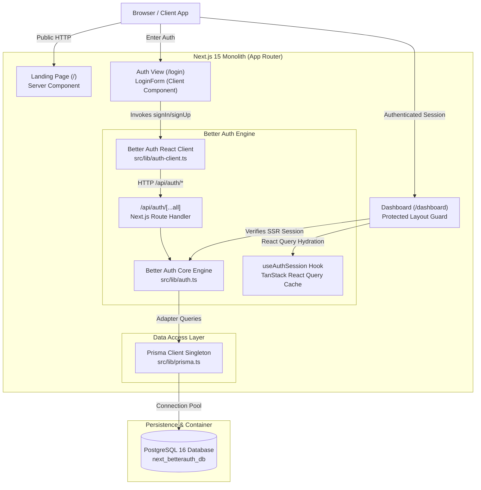
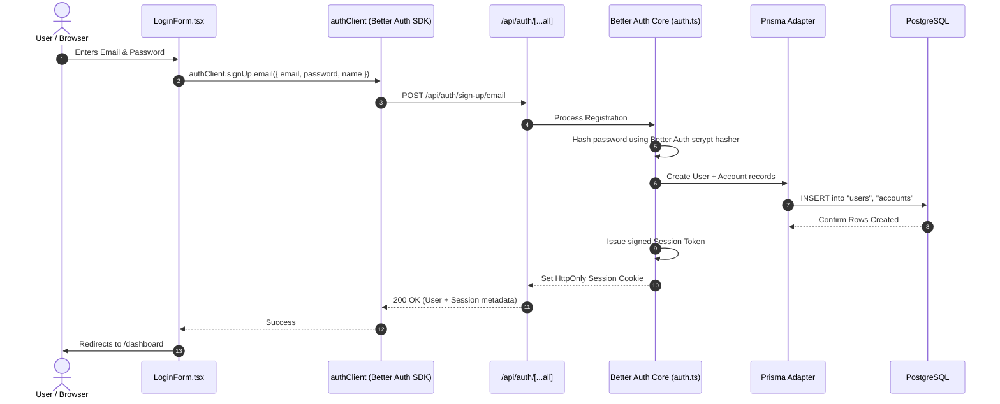
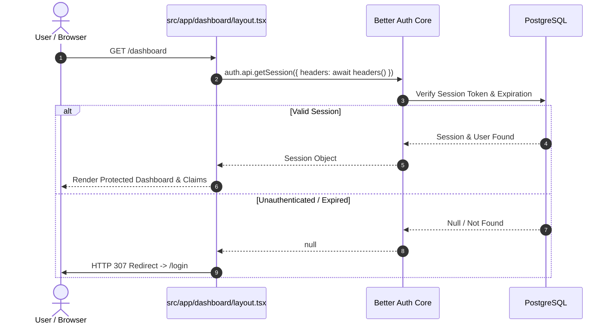

# System Architecture & Technical Specification

`next-betterAuth-monolith-template` is a modular, production-ready monolithic template built with **Next.js 15 (App Router)**, **Better Auth**, and **Prisma ORM (PostgreSQL)**.

---

## 1. High-Level Architectural Diagram



---

## 2. Authentication Flow

### Sign Up / Registration



### Server-Side Route Protection (`/dashboard`)



---

## 3. Directory & File Breakdown

| Path                                | Purpose                                                                                            |
| :---------------------------------- | :------------------------------------------------------------------------------------------------- |
| `docker-compose.yml`                | Container definition for PostgreSQL 16 published on host port `5439` with volume persistence.      |
| `prisma/migrations/`                | Versioned SQL migration history; `pnpm db:migrate` is the supported path to a schema change.       |
| `prisma/schema.prisma`              | Source of truth for database models: `User`, `Account`, `Session`, and `Verification`.             |
| `prisma/seed.ts`                    | Database seeding script using `better-auth/crypto` scrypt hasher to provision `admin@example.com`. |
| `src/lib/config.ts`                 | Client-safe environment variables, parsed and validated with Zod at module load.                   |
| `src/lib/config.server.ts`          | Server-only secrets (`DATABASE_URL`, `AUTH_SECRET`), parsed with Zod; throws if invalid.           |
| `src/lib/session.ts`                | `requireAuth()` / `getCurrentSession()` — the reusable server-side session guard.                  |
| `src/lib/prisma.ts`                 | Global singleton instance for PrismaClient preventing hot-reload connection leaks.                 |
| `src/lib/auth.ts`                   | Core server configuration for Better Auth with Prisma PostgreSQL adapter.                          |
| `src/lib/auth-client.ts`            | Client SDK instance for React components (`signIn`, `signUp`, `signOut`, `useSession`).            |
| `src/hooks/useAuthSession.ts`       | React Query-backed session hook with 5-minute stale-time and cache invalidation.                   |
| `src/providers/query-provider.tsx`  | Global TanStack Query provider.                                                                    |
| `src/components/auth/LoginForm.tsx` | Client authentication component with tab switching, password peek, and validation.                 |
| `src/components/ui/`                | Primitive UI components (`Button.tsx`, `Card.tsx`, `Input.tsx`).                                   |
| `src/app/page.tsx`                  | Production-styled landing page featuring hero section, feature cards, and navigation.              |
| `src/app/login/page.tsx`            | Dedicated auth page wrapping `LoginForm`.                                                          |
| `src/app/dashboard/layout.tsx`      | Server component guard ensuring only authenticated sessions enter `/dashboard`.                    |
| `src/app/dashboard/page.tsx`        | Authenticated overview screen displaying session claims and active sign-out handler.               |
| `src/app/globals.css`               | Cyberpunk/slate design tokens, glassmorphism utilities, and gradient definitions.                  |

---

## 4. Database Schema Specification

```
┌─────────────────────────────────┐       ┌─────────────────────────────────┐
│              User               │       │             Account             │
├─────────────────────────────────┤       ├─────────────────────────────────┤
│ id: String (cuid) [PK]          │◄──┐   │ id: String (cuid) [PK]          │
│ email: String [UNIQUE]          │   └───┤ userId: String [FK]             │
│ name: String?                   │       │ accountId: String               │
│ image: String?                  │       │ providerId: String              │
│ emailVerified: Boolean          │       │ password: String? (scrypt hash) │
│ createdAt: DateTime             │       │ accessToken: String?            │
│ updatedAt: DateTime             │       │ refreshToken: String?           │
└─────────────────────────────────┘       │ createdAt: DateTime             │
               │                          │ updatedAt: DateTime             │
               │                          └─────────────────────────────────┘
               │ 1:N
               ▼
┌─────────────────────────────────┐       ┌─────────────────────────────────┐
│             Session             │       │          Verification           │
├─────────────────────────────────┤       ├─────────────────────────────────┤
│ id: String (cuid) [PK]          │       │ id: String (cuid) [PK]          │
│ token: String [UNIQUE]          │       │ identifier: String [INDEX]      │
│ userId: String [FK]             │       │ value: String                   │
│ expiresAt: DateTime             │       │ expiresAt: DateTime             │
│ ipAddress: String?              │       │ createdAt: DateTime             │
│ userAgent: String?              │       │ updatedAt: DateTime             │
│ createdAt: DateTime             │       └─────────────────────────────────┘
│ updatedAt: DateTime             │
└─────────────────────────────────┘
```

---

## 5. Security & Best Practices Implemented

1. **Native Cryptographic Password Hashing**: Passwords are never stored in plaintext and are hashed using Better Auth's internal scrypt implementation (`better-auth/crypto`), ensuring zero compatibility issues across login and seed routines.
2. **Server-Side Session Guarding**: `src/app/dashboard/layout.tsx` calls `requireAuth()` from `src/lib/session.ts`, which verifies the session against the database — not merely the presence of a cookie — before emitting HTML, mitigating client-side flash-of-unauthenticated-content (FOUC). New protected routes should call the same helper rather than re-implementing the check.
3. **Reactive Query Invalidation**: Client-side auth mutations invalidate TanStack React Query keys (`["auth", "session"]`), updating the UI state immediately without hard page reloads.
4. **Environment Isolation**: Server-only secrets (`DATABASE_URL`, `AUTH_SECRET`) live in `config.server.ts`, which is never imported by a client component, keeping them out of the browser bundle. Both that module and the client-safe `config.ts` parse their variables through Zod at import time, so an absent or too-short `AUTH_SECRET` aborts the build instead of silently falling back to Better Auth's development default.
5. **Aligned Password Policy**: `MIN_PASSWORD_LENGTH` in `config.ts` is consumed by both the Better Auth server config and the sign-up form, so client-side validation cannot drift from the server's floor.
